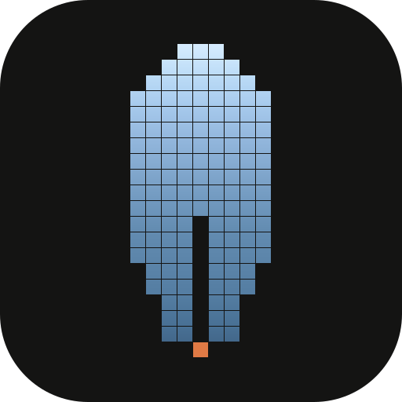

<p align="center">
  
</p>

<p align="center"><b>Text lives here. Nothing leaves the machine.</b></p>

<p align="center">
  github.com/Raghav2012Code/nib — source, spec and releases.<br>
  Liked nib? <a href="https://github.com/Raghav2012Code/nib">Star it there</a>, one click is enough.
</p>

<p align="center">
  <a href="docs/spec.md"></a>
  <a href="docs/design/cli-splash.md"></a>
  
  
</p>

A native Windows app with a terminal beside it, both over one local store. Windows 10 and 11 first. Plain text pastes, up to 64 KB each, full-text search over every one of them. No account, no trial, no telemetry, no network calls.

**Pre-alpha.** The design is written and the mark is drawn; there is no code yet. What follows is what the first release does, not what builds today.

|  |  |  |  |
|:---:|:---:|:---:|:---:|
| **Local only** | **Searchable** | **Portable** | **Open** |
| 0 bytes uploaded | Content, not titles | One file per export | MIT license |
| One SQLite file on your disk | FTS5 over every paste, snippets too | No link, no relay, no service | Source, spec and design in the repo |

## In the terminal

```
echo "kubectl get pods -A" | nib   # 4f2a
nib search "get pods"              # by content
nib 4f2a > run.txt                 # byte-exact
```

`nib` alone opens a three-line launcher: add, find, recent. No full-screen TUI, no arrow keys, no modes.

## Secrets

Any paste can be sealed with its own passphrase — Argon2id plus XChaCha20-Poly1305. A sealed paste is never indexed, so search cannot leak it, and its label is the only thing stored in the clear.

## Docs

- [Design spec](docs/spec.md) — scope, data model, CLI surface, app, packaging
- [CLI splash](docs/design/cli-splash.md) — the screen, the mark, the rules
- [Logo](docs/design/logo.md) — the terminal mark and the SVG assets
- [Questionnaire](docs/design/questionnaire.md) — the questions the design answers

## Install

Not yet. Later: an unsigned Windows installer, and `cargo install --git` for the CLI. The crate names `nib` and `nib-cli` are taken on crates.io, so there will be no `cargo install nib`.

## License

MIT
